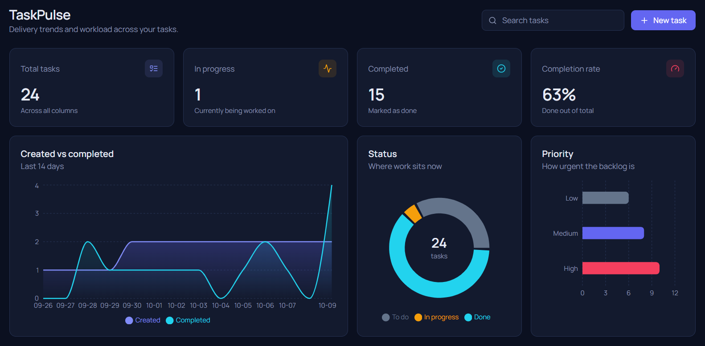
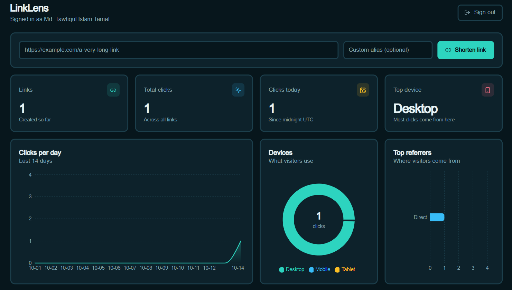

<div align="center">

# Full-Stack Projects

**A collection of production-style projects built with TypeScript, Node.js, Express.js and Next.js.**


</div>

## About

I'm **Md. Tawfiqul Islam Tamal**, a Computer Science & Engineering student focused on building complete web applications, from the typed REST API to the interactive UI. This repository is my workspace for those projects. Each one lives in its own folder with its own README, setup steps and tests, so you can open any project and run it in a few minutes.

**What I'm practising here**

- Designing clean REST APIs with validation, error handling and security basics
- Building responsive, accessible interfaces with the Next.js App Router
- Sharing types between frontend and backend to catch bugs early
- Writing tests and CI pipelines so every project stays reliable





## Projects

| Project | Description | Stack | Status |
| --- | --- | --- | --- |
| [TaskPulse](projects/taskpulse) | Task analytics dashboard with KPI cards, charts and a board | Next.js, Express, TypeScript, Tailwind, Recharts | Complete |
| [LinkLens](projects/linklens) | Link shortener with JWT auth and click analytics dashboard | Next.js, Express, TypeScript, JWT, Recharts | Complete |
| _Next project_ | _Coming soon_ | | Planned |

> Add a row to this table every time you add a project. Link to its folder and keep the description to one line.

## Tech stack

| Area | Tools |
| --- | --- |
| Language | TypeScript |
| Frontend | Next.js (App Router), React, Tailwind CSS, Recharts |
| Backend | Node.js, Express.js, Zod |
| Auth | JWT, bcrypt |
| Testing | Vitest, Supertest |
| Tooling | npm workspaces, GitHub Actions, Git |

## Repository structure

```
Full-Stack-Projects/
├── projects/
│   ├── taskpulse/            Task analytics dashboard
│   │   ├── apps/api/         Express + TypeScript API
│   │   ├── apps/web/         Next.js frontend
│   │   └── README.md
│   ├── linklens/             Link shortener with click analytics
│   │   ├── apps/api/         Express + TypeScript API (JWT auth)
│   │   ├── apps/web/         Next.js frontend
│   │   └── README.md
│   └── <next-project>/
├── docs/                     Screenshots and notes
├── .github/workflows/        CI
├── LICENSE
└── README.md
```

## Running a project

Every project is self-contained. Pick one and follow its README, or use this quick start:

```bash
git clone https://github.com/Tawfiqul-Tamal/Full-Stack-Projects.git
cd Full-Stack-Projects/projects/taskpulse
npm install
npm run dev
```

**Requirements:** Node.js 18.18 or newer and npm 9 or newer.

## Project conventions

All projects follow the same standards so the codebase stays consistent:

- **TypeScript strict mode** in every app
- **Validation at the boundary** with Zod for request bodies and query strings
- **Layered backend:** routes, services, then a repository or store
- **One README per project** with setup, API reference and design decisions
- **Conventional commits** such as `feat:`, `fix:`, `docs:` and `test:`
- **Tests and typecheck** must pass before merging

## Roadmap

- [ ] Add a project with PostgreSQL and Prisma
- [x] Add a project with JWT authentication
- [ ] Add a real-time project with WebSockets
- [ ] Add Docker Compose files for each project
- [ ] Add end-to-end tests with Playwright

## Author

**Md. Tawfiqul Islam Tamal**

- GitHub: [@Tawfiqul-Tamal](https://github.com/Tawfiqul-Tamal)
- LinkedIn: [Md. Tawfiqul Islam Tamal](https://www.linkedin.com/in/md-tawfiqul-islam-tamal-793bb429a/)
- Email: [tamaltawfiqul@gmail.com](mailto:tamaltawfiqul@gmail.com)

## Copyright

Copyright &copy; 2026 Md. Tawfiqul Islam Tamal. All rights reserved under the terms of the MIT License.

Created by Md. Tawfiqul Islam Tamal.

## License

Released under the [MIT License](LICENSE). You are free to use, copy and modify the code, provided the copyright notice is kept.
