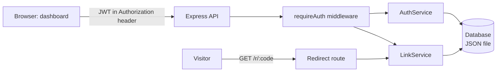

<div align="center">

# LinkLens

**A link shortener with JWT authentication and a click analytics dashboard: see who opens your links, from where and on which device.**


</div>


## Overview

LinkLens turns long URLs into short ones and records every visit. Each account gets a private dashboard with daily clicks, a device breakdown and top referrers, so you can see which links actually get opened.

It is a **npm workspaces monorepo**: an Express + TypeScript API (`apps/api`) and a Next.js App Router frontend (`apps/web`).

## Features

- Account system: register, sign in and stay signed in, using JWT access tokens and bcrypt password hashing
- Short links with optional custom aliases and duplicate-alias protection
- Public redirect endpoint (`/r/:code`) that records the visit before forwarding the visitor
- Click analytics per user: clicks per day (14 days), device split, top referrers and top links
- Links and numbers are private to each account, and one user cannot read or delete another user's links
- Zod validation on every request, Helmet headers, CORS allow-list and rate limits (stricter on sign-in routes)
- JSON-file persistence behind a small `Database` class, so data survives restarts and a real database can replace it later
- Integration tests with Vitest and Supertest
- "Load sample data" button to fill a new dashboard with two weeks of demo clicks

## Tech stack

| Layer | Technology |
| --- | --- |
| Frontend | Next.js 14 (App Router), React 18, TypeScript, Tailwind CSS, Recharts, lucide-react |
| Backend | Node.js, Express 4, TypeScript, Zod, jsonwebtoken, bcryptjs, Helmet, express-rate-limit |
| Testing | Vitest, Supertest |
| Tooling | npm workspaces, GitHub Actions, concurrently |

## Architecture



## Getting started

### Prerequisites

- Node.js 18.18 or newer
- npm 9 or newer

### Install and run

```bash
cd projects/linklens
npm install
cp .env.example apps/api/.env
cp .env.example apps/web/.env.local
npm run dev
```

- Web app: http://localhost:3001
- API health check: http://localhost:4001/api/health

Create an account on the web app, then click **Load sample data** to see the charts filled in.

### Scripts

| Command | What it does |
| --- | --- |
| `npm run dev` | Runs API and web together |
| `npm run dev:api` / `npm run dev:web` | Runs one of them |
| `npm test` | Runs the API test suite |
| `npm run typecheck` | Type-checks both apps |
| `npm run build` | Production build of both apps |

### Environment variables

| Variable | App | Default | Purpose |
| --- | --- | --- | --- |
| `PORT` | api | `4001` | API port |
| `CLIENT_ORIGIN` | api | `http://localhost:3001` | Origin allowed by CORS |
| `BASE_URL` | api | `http://localhost:4001` | Public base of generated short links |
| `JWT_SECRET` | api | dev-only value | Secret used to sign tokens. **Required in production** |
| `NEXT_PUBLIC_API_URL` | web | `http://localhost:4001/api` | API base URL used by the dashboard |

## API reference

Base URL: `/api`. Routes marked 🔒 need an `Authorization: Bearer <token>` header.

| Method | Endpoint | Description |
| --- | --- | --- |
| POST | `/auth/register` | Create an account and receive a token |
| POST | `/auth/login` | Sign in and receive a token |
| GET | `/auth/me` 🔒 | Current user |
| GET | `/links` 🔒 | List your links with click counts |
| POST | `/links` 🔒 | Create a link: `{ "url": "...", "alias": "optional" }` |
| POST | `/links/demo` 🔒 | Add sample links and clicks |
| DELETE | `/links/:id` 🔒 | Delete a link and its clicks |
| GET | `/analytics` 🔒 | KPIs, 14-day trend, devices, referrers, top links |
| GET | `/r/:code` | Public redirect (records the click) |

Example:

```bash
curl -X POST http://localhost:4001/api/auth/register \
  -H "Content-Type: application/json" \
  -d '{"name":"Ada Lovelace","email":"ada@example.com","password":"supersecret1"}'
```

## Project structure

```
linklens/
├── apps/
│   ├── api/src/
│   │   ├── routes/        auth and links routers
│   │   ├── services/      AuthService, LinkService (analytics logic)
│   │   ├── middleware/    requireAuth, error handling
│   │   ├── store/         Database (JSON file)
│   │   ├── schemas.ts     Zod schemas
│   │   └── tests/         Vitest + Supertest
│   └── web/
│       ├── app/           Next.js pages
│       ├── components/    Dashboard, charts, link table, auth form
│       └── lib/           API client, types, theme tokens
├── docs/                  Screenshots
└── package.json           npm workspaces root
```

## Design decisions

- **Services over fat routes.** Routes parse input and call `AuthService` or `LinkService`. All rules (alias uniqueness, ownership checks, analytics maths) live in services and are covered by tests.
- **Ownership checks in the data layer.** Deleting a link looks it up by both `id` and `userId`, so another user's link returns 404 instead of leaking that it exists.
- **Same error for wrong email and wrong password.** Sign-in never reveals which part was incorrect.
- **Replaceable storage.** Only the `Database` class touches the disk. Swapping it for PostgreSQL with Prisma does not change routes or services.

## Known limitations

- The token is stored in `localStorage`. For a production app, move it to an `httpOnly` cookie.
- The JSON-file database suits a single server. Use PostgreSQL for multiple instances.
- Device detection uses a simple user-agent check, and referrer data depends on what the visitor's browser sends.

## Roadmap

- [ ] PostgreSQL + Prisma storage
- [ ] httpOnly cookie sessions with refresh tokens
- [ ] QR code for each short link
- [ ] Link expiry dates and click limits
- [ ] Country-level analytics

## Author

**Md. Tawfiqul Islam Tamal**

- GitHub: [@Tawfiqul-Tamal](https://github.com/Tawfiqul-Tamal)
- LinkedIn: [Md. Tawfiqul Islam Tamal](https://www.linkedin.com/in/md-tawfiqul-islam-tamal-793bb429a/)
- Email: [tamaltawfiqul@gmail.com](mailto:tamaltawfiqul@gmail.com)

## Copyright

Copyright &copy; 2026 Md. Tawfiqul Islam Tamal. Created by Md. Tawfiqul Islam Tamal.

## License

Released under the [MIT License](LICENSE).
