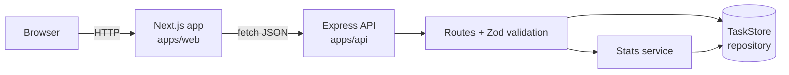

<div align="center">

# TaskPulse

**A full-stack task analytics dashboard: see what is being worked on, what is done, and how fast the team is moving.**


</div>


## Overview

TaskPulse pairs a typed REST API with a Next.js dashboard. Tasks move through a three-column board, and every change updates the KPI cards and charts straight away: created vs completed over 14 days, status breakdown and priority workload.

The project is built as an **npm workspaces monorepo** so the API and the web app live in one repository, share tooling, and run with a single command.

## Features

- Interactive dashboard with KPI cards, an area chart, a donut chart and a bar chart (Recharts)
- Board with three columns (To do, In progress, Done), move and delete actions, and live search
- REST API with full CRUD, filtering by status, priority and free text
- Request validation with Zod and consistent, readable error responses
- Security basics: Helmet headers, CORS allow-list, rate limiting and a request body size cap
- Repository pattern, so the in-memory store can be replaced by a real database without touching the routes
- Integration tests with Vitest and Supertest, plus a GitHub Actions pipeline (typecheck, test, build)
- Accessible UI: keyboard focus styles, labelled controls, dialog semantics and reduced-motion support

## Tech stack

| Layer | Technology |
| --- | --- |
| Frontend | Next.js 14 (App Router), React 18, TypeScript, Tailwind CSS, Recharts, lucide-react |
| Backend | Node.js, Express 4, TypeScript, Zod, Helmet, express-rate-limit, Morgan |
| Testing | Vitest, Supertest |
| Tooling | npm workspaces, GitHub Actions, concurrently |

## Architecture



## Getting started

### Prerequisites

- Node.js 18.18 or newer
- npm 9 or newer

### Install and run

```bash
git clone https://github.com/Tawfiqul-Tamal/Full-Stack-Projects.git
cd Full-Stack-Projects/projects/taskpulse
npm install
cp .env.example apps/api/.env
cp .env.example apps/web/.env.local   # keep only the NEXT_PUBLIC_API_URL line if you like
npm run dev
```

- Web app: http://localhost:3000
- API: http://localhost:4000/api/health

The API starts with 24 seeded tasks so the charts have data on the first run.

### Scripts

| Command | What it does |
| --- | --- |
| `npm run dev` | Runs API and web together |
| `npm run dev:api` / `npm run dev:web` | Runs one of them |
| `npm test` | Runs the API test suite |
| `npm run typecheck` | Type-checks both apps |
| `npm run build` | Production build of both apps |

### Environment variables

| Variable | App | Default | Purpose |
| --- | --- | --- | --- |
| `PORT` | api | `4000` | API port |
| `CLIENT_ORIGIN` | api | `http://localhost:3000` | Origin allowed by CORS |
| `NEXT_PUBLIC_API_URL` | web | `http://localhost:4000/api` | Base URL the dashboard calls |

## API reference

Base URL: `/api`

| Method | Endpoint | Description |
| --- | --- | --- |
| GET | `/health` | Liveness check |
| GET | `/tasks` | List tasks. Query: `status`, `priority`, `q` |
| GET | `/tasks/:id` | Get one task |
| POST | `/tasks` | Create a task |
| PATCH | `/tasks/:id` | Update title, description, status or priority |
| DELETE | `/tasks/:id` | Delete a task |
| GET | `/stats` | KPIs, status and priority counts, 14-day trend |

Example:

```bash
curl -X POST http://localhost:4000/api/tasks \
  -H "Content-Type: application/json" \
  -d '{"title":"Write project README","priority":"high"}'
```

Validation errors return `400` with a message and a list of field issues:

```json
{
  "message": "Title must be at least 3 characters",
  "issues": [{ "path": "title", "message": "Title must be at least 3 characters" }]
}
```

## Project structure

```
taskpulse/
├── apps/
│   ├── api/
│   │   └── src/
│   │       ├── routes/        HTTP handlers
│   │       ├── services/      Stats calculation
│   │       ├── store/         Repository and seed data
│   │       ├── middleware/    Error handling
│   │       ├── schemas.ts     Zod schemas
│   │       └── tests/         Vitest + Supertest
│   └── web/
│       ├── app/               Next.js App Router pages
│       ├── components/        Charts, board, dialog, cards
│       └── lib/               API client, types, theme tokens
├── .github/workflows/ci.yml
└── package.json               npm workspaces root
```

## Design decisions

- **Repository pattern.** Routes only call `list`, `get`, `create`, `update` and `remove`. Replacing the in-memory store with Prisma or MongoDB is a change in one file.
- **Validation at the edge.** Every body and query string goes through Zod before reaching business logic, and one error middleware formats all failures.
- **Derived data on the server.** Completion rate and the 14-day trend are computed in a pure function (`computeStats`) that is easy to unit test.
- **Design tokens.** Colours for status and priority live in `apps/web/lib/theme.ts`, so charts and badges always match.

## Roadmap

- [ ] Persistent storage with PostgreSQL and Prisma
- [ ] JWT authentication and per-user workspaces
- [ ] Drag and drop between board columns
- [ ] Docker Compose for one-command setup
- [ ] End-to-end tests with Playwright

## Contributing

Issues and pull requests are welcome. Run `npm run typecheck && npm test` before opening a PR.

## Author

**Md. Tawfiqul Islam Tamal**

- GitHub: [@Tawfiqul-Tamal](https://github.com/Tawfiqul-Tamal)
- LinkedIn: [Md. Tawfiqul Islam Tamal](https://www.linkedin.com/in/md-tawfiqul-islam-tamal-793bb429a/)
- Email: [tamaltawfiqul@gmail.com](mailto:tamaltawfiqul@gmail.com)

## Copyright

Copyright &copy; 2026 Md. Tawfiqul Islam Tamal. Created by Md. Tawfiqul Islam Tamal.

## License

Released under the [MIT License](LICENSE).
